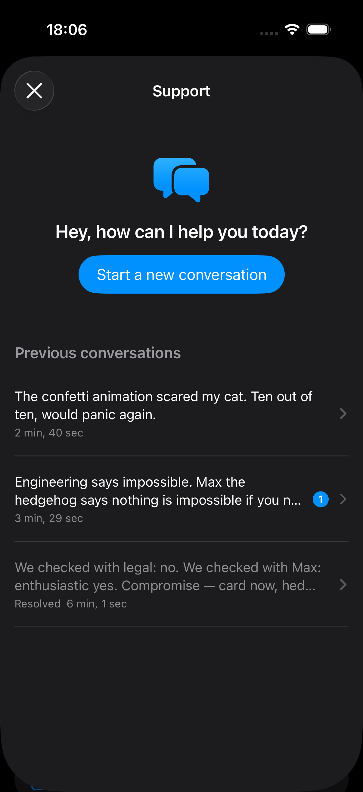
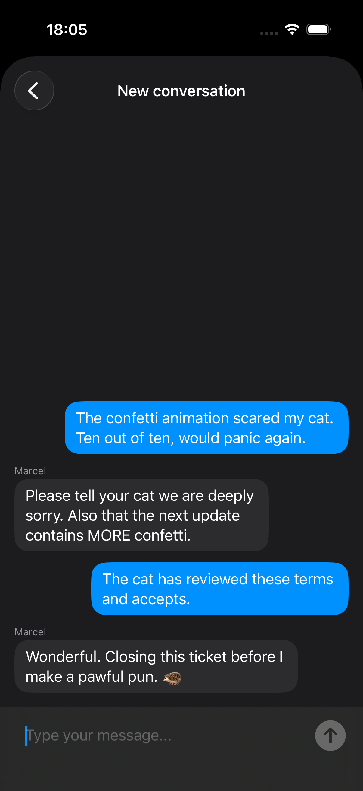
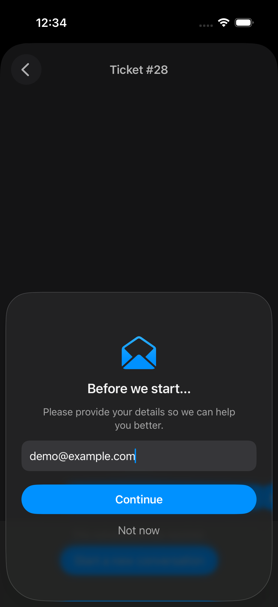

# posthog-ios-support-chat

[](https://github.com/hoppsen/posthog-ios-support-chat/actions/workflows/building.yml)
[](https://github.com/hoppsen/posthog-ios-support-chat/actions/workflows/testing.yml)
[](https://github.com/hoppsen/posthog-ios-support-chat/actions/workflows/linting.yml)


[](LICENSE)

Native iOS support chat built on [PostHog Support (Conversations)](https://posthog.com/docs/support/widget) — the same backend and client protocol as PostHog's web support widget, with a SwiftUI chat UI. Tickets land in your PostHog inbox with person profiles, session context, and analytics attached. No extra SaaS, no custom backend.

> **Unofficial.** This is a community package, not maintained by PostHog. It speaks the client-side widget protocol used by posthog-js (`/api/conversations/v1/widget/*`), which is beta and may change. When official mobile Conversations support lands in [posthog-ios](https://github.com/PostHog/posthog-ios) (tracked in [PostHog/posthog#56771](https://github.com/PostHog/posthog/issues/56771)), the transport layer here can be swapped out while keeping the UI.

<p align="center">
  
  &nbsp;
  
  &nbsp;
  
</p>

## Requirements

- iOS 17+
- PostHog project with **Support enabled** (Settings → Support). The web widget toggle can stay off; only the API needs to be enabled.

## Products

| Product | What it is |
|---|---|
| `PostHogSupportChat` | SwiftUI chat UI (`SupportChatView`) + everything below |
| `PostHogSupportChatClient` | Transport only: API client, models, Keychain session store — bring your own UI |

## Usage

```swift
import PostHogSupportChat
import PostHogSupportChatClient

// Bridge your PostHog SDK state (avoids a hard dependency on posthog-ios):
struct PostHogContext: SupportChatContextProvider {
    var distinctId: String { PostHogSDK.shared.getDistinctId() }
    var sessionId: String? { PostHogSDK.shared.getSessionId() }
}

let supportChat = SupportChatClient(
    configuration: .init(
        projectApiKey: "phc_...",
        host: .us,
        // Recommended: your website's origin. Required for sending messages
        // if your Support settings restrict allowed domains; harmless otherwise.
        origin: URL(string: "https://example.com")
    ),
    context: PostHogContext()
)

// Present the chat:
.sheet(isPresented: $showSupport) {
    SupportChatView(client: supportChat)
}
```

Refresh the unread badge on app foreground:

```swift
try? await supportChat.refreshTickets()   // supportChat.unreadCount
```

### Copy and localization

Every user-facing string resolves in this order:

```
strings: parameter (your app)  →  the package's translations (54 languages)
```

Copy configured in the PostHog dashboard is skipped unless you opt in, in which case it slots in between:

```
strings: parameter  →  PostHog dashboard  →  the package's translations
```

That default is deliberate. Enabling Support pre-fills the dashboard fields with English defaults (`Hey, how can I help you today?`, `Type your message...`, …), and **PostHog stores no translations for them** — unlike surveys. Using them would show English to every user regardless of locale, in place of the translations this package exists to provide. Left alone, those fields stay free to configure a web widget independently.

Override only what you want to word yourself:

```swift
SupportChatView(
    client: supportChat,
    strings: .init(
        greeting: LocalizedStringResource("Hi! How can we help?", comment: "Support chat greeting"),
        placeholder: LocalizedStringResource("Type your message…", comment: "Support chat input"),
        identificationTitle: LocalizedStringResource("Before we start…", comment: "Support email form title"),
        identificationDescription: LocalizedStringResource("Add your email so we can get back to you.",
                                                           comment: "Support email form description")
    )
)
```

`LocalizedStringResource` resolves at display time, so these follow an in-app language switcher; in an app they default to the main bundle, so Xcode extraction and existing translation tooling pick them up.

### Using the dashboard copy instead

```swift
SupportChatConfiguration(projectApiKey: "phc_...", usesDashboardStrings: true)
```

Worth it for a single-language app that wants to reword the greeting without shipping a release, or to keep an iOS chat and a web widget identical. The trade is the one above: whatever is typed in the dashboard is what every user sees, in that one language. Anything you pass in `strings:` still wins, and the bundled translations still fill fields the dashboard leaves empty.

### Tint

The chat draws itself in the environment tint, so it picks up your app's accent with no configuration — and you can override it per presentation:

```swift
SupportChatView(client: supportChat)
    .tint(.brandGreen)
```

One caveat if you present the chat in its own `UIWindow` (see below): a new window starts a fresh SwiftUI environment, so a `.tint(…)` applied to your app's root view does **not** reach it. It falls back to the `AccentColor` asset, which is the system blue if you set your accent programmatically instead. Apply `.tint(…)` to the `SupportChatView` you put in the window.

### Mirroring chat activity into your analytics

PostHog captures an internal `$conversation_ticket_created` event server-side, but it is **personless** — workflows keyed on it cannot use person properties. The client's `onEvent` hook lets your app capture its own events with full person processing, which is the right trigger for person-based workflows (e.g. "notify me with the customer's context when a ticket is created"):

```swift
supportChat.onEvent = { event in
    switch event {
    case let .messageSent(ticketId, isNewTicket):
        PostHogSDK.shared.capture("support:chat_message_sent",
                                  properties: ["ticket_id": ticketId, "is_new_ticket": isNewTicket])
    case let .identificationSubmitted(email, name):
        // `email` and `name` (unprefixed) are the properties PostHog uses to
        // display a person, so writing them turns UUIDs into readable names
        // across persons, activity, and the support inbox. This sets
        // properties on the existing person — it does not identify or merge
        // anyone, and the address is unverified, so treat it as a label.
        var person: [String: Any] = [:]
        if let email { person["email"] = email }
        if let name { person["name"] = name }
        PostHogSDK.shared.capture("support:chat_identification_submit",
                                  userProperties: person)
    }
}
```

### Feedback entry point (e.g. a Home Screen quick action)

For entry points that should always reach users — like a "Send Feedback" quick action shown when someone long-presses your app icon — present the chat in its own `UIWindow` so it appears above everything, including full-screen covers a SwiftUI sheet cannot present over:

```swift
@MainActor private var overlayWindow: UIWindow?

@MainActor
func presentFeedbackChat(in scene: UIWindowScene) {
    guard overlayWindow == nil else { return }
    supportChat.additionalTraits = ["source": "quick_action"]  // shows up on the ticket in your inbox

    let window = UIWindow(windowScene: scene)
    window.windowLevel = .alert
    window.rootViewController = UIViewController()
    window.makeKeyAndVisible()

    let chat = SupportChatView(
        client: supportChat,
        startNewConversation: true,   // straight into a fresh conversation
        strings: .init(greeting: LocalizedStringResource("We read every message. What can we do better?",
                                                         comment: "Support chat greeting for the feedback action"))
    )
    .tint(.brandGreen)   // a new window does not inherit the app's environment tint

    let host = DismissReportingHostingController(rootView: chat)
    host.onDismiss = { dismissOverlay() }
    overlayWindow = window

    // Defer one runloop: presenting synchronously during scene activation can
    // be silently dropped (e.g. while a system alert holds key after launch).
    DispatchQueue.main.async {
        window.rootViewController?.present(host, animated: true)
        // Self-heal if the presentation was dropped anyway, so the next
        // attempt is not swallowed by the singleton guard above.
        DispatchQueue.main.asyncAfter(deadline: .now() + 1.5) {
            if host.presentingViewController == nil { dismissOverlay() }
        }
    }
}

@MainActor
func dismissOverlay() {
    overlayWindow?.isHidden = true
    overlayWindow = nil
}

/// Reports dismissal (close button or swipe) so the window can be torn down.
private final class DismissReportingHostingController<Content: View>: UIHostingController<Content> {
    var onDismiss: (() -> Void)?

    override func viewDidDisappear(_ animated: Bool) {
        super.viewDidDisappear(animated)
        if isBeingDismissed { onDismiss?() }
    }
}
```

### Push notifications for replies

People rarely sit in the chat waiting for an answer, so replies they never see are the main failure mode of in-app support. PostHog Workflows can push a notification to the customer's device when someone replies from the inbox. The work splits three ways:

| Who | Does what |
|---|---|
| PostHog | A workflow sends the push when your team replies |
| Your app | Push setup: capability, permission, registering with iOS, the notification delegate, presenting the chat |
| This package | Opens the right ticket from a tap, tells you which ticket is on screen, and can offer a "Get notified when we reply" row |

The package stays dependency-free and never registers for push itself.

**Requirements**

- **posthog-ios 3.69.0 or newer in your app.** That is the first version that registers device tokens with PostHog (automatically, once your app calls `registerForRemoteNotifications()`). Older SDK versions leave the device unreachable, and the workflow logs `No active APNS device token found for distinct_id`.
- The **Push Notifications** capability on your app target.
- An **APNs channel** in PostHog under Workflows → Channels, matching your bundle id. Use Production for TestFlight and App Store builds, Sandbox for builds run from Xcode — a mismatch drops pushes silently. For anonymous users, leave **Identity verification** disabled: it needs a server that knows who owns a distinct id, which an app without accounts does not have.

**1. The workflows**

The step-by-step setup, including the exact workflow definitions to create over PostHog MCP, test-run and verification steps, and troubleshooting, is in [PostHogWorkflows.md](PostHogWorkflows.md).

A push step delivers to the person the workflow run belongs to — its "Distinct ID" field only appears in log messages ([PostHog/posthog#120326](https://github.com/PostHog/posthog/issues/120326)). A reply event belongs to the team member who replied, so a single workflow on it would look for the team member's device. Two workflows hand the reply over to the customer instead:

```
Team replies in the inbox
  → $conversation_message_sent        (belongs to the team member)
      → Workflow A: Get ticket → capture support:reply_received for the customer
          → support:reply_received    (belongs to the customer)
              → Workflow B: push to the customer's device
```

**Workflow A** — "Support reply → customer event":

| Step | Configuration |
|---|---|
| Trigger | Event `$conversation_message_sent`, filtered to `channel_source = widget` and `author_type = team` |
| Get conversation ticket | Ticket ID `{event.properties.ticket_id}` (the default), output variable `ticket` |
| Capture a PostHog event | Event `support:reply_received`, distinct ID `{variables.ticket.distinct_id}`, properties `ticket_id`, `ticket_number`, `message_id`, `message_content` copied from `{event.properties.*}` |

**Workflow B** — "Support reply push (iOS)":

| Step | Configuration |
|---|---|
| Trigger | Event `support:reply_received` |
| Push notification | Distinct ID `{event.distinct_id}`, your **production** APNs channel, a title such as "New reply from support", body `{{ event.properties.message_content \| strip_html \| truncate: 180 }}`, custom data `{"type": "support_reply", "ticket_id": "{event.properties.ticket_id}"}` |

The ticket carries the customer's distinct id: whatever your `SupportChatContextProvider.distinctId` returned when the ticket was created, so it must return `PostHogSDK.shared.getDistinctId()`, the id the SDK registers the device under. The custom data keys must match `SupportChatNotification`.

Expect a minute or two between the reply and the push: the captured event goes through PostHog's ingestion before it triggers workflow B. Once the push step honors its Distinct ID, the push moves into workflow A (`{variables.ticket.distinct_id}`) and the delay disappears; the app side stays the same.

Select only the production channel in a live workflow. Tokens carry no APNs environment, so with a sandbox channel selected too, every push is also sent to the wrong environment and logs a `BadDeviceToken` error. Add the sandbox channel only while testing a build run from Xcode.

Inbox replies are markdown, so a preview can show escapes such as `\.` (the workflow's Liquid templating rejects backslashes, so they cannot be stripped there). A preview also puts up to 180 characters of the reply on the lock screen. Use a generic body such as "You have a new reply" if replies may be sensitive.

**2. The app**

What to set up, and what each piece buys you. The reference code below has all of it; leave out what you don't need.

| Piece | | Without it |
|---|---|---|
| posthog-ios 3.69.0+, Push Notifications capability | Required | The device never registers; PostHog has nowhere to send |
| `requestReplyNotifications()` via `requestNotifications:` | Required | Nobody is asked; only provisional permission (if set up) can reach people |
| Notification delegate set in `didFinishLaunching` | Required | Taps do nothing, and a tap that cold-launches the app is lost; posthog-ios can't record opens |
| `handleNotificationTap` → `chatView(ticketId:)` | Required | A tap opens the app, not the conversation |
| `requestProvisionalReplyNotifications()` on a new ticket | Recommended | People who never tap "Turn on" get no notification at all |
| `refreshPushRegistration()` at launch | Recommended | A rotated APNs token goes stale until permission is requested again |
| A Settings row (`NotificationsSettingsRow`) | Recommended | After a "Don't Allow" there is no way back in the app |
| `presentationOptions(for:)` | Optional | A banner also shows for the conversation already on screen |
| Badge clearing in `chatView` | Optional | The badge the workflow sets stays on the app icon |

posthog-ios picks up the device token on its own once the app registers, and stores it on the person. Keep `aps-environment` at `development` in the entitlements file: App Store and TestFlight exports replace it with the distribution profile's `production`.

<details>
<summary><b>Reference implementation</b> — <code>SupportChatService</code>, app delegate, Settings row (compiles against 0.5.0)</summary>

```swift
import PostHog
import PostHogSupportChat
import PostHogSupportChatClient
import SwiftUI
import UserNotifications

/// App-side wiring for the support chat and reply notifications.
@MainActor
enum SupportChatService {
    static let client: SupportChatClient = {
        let client = SupportChatClient(configuration: .init(projectApiKey: "phc_...", host: .us),
                                       context: PostHogContext())
        client.onEvent = { event in
            // Quiet permission on a new conversation: replies land in Notification Center
            // even if the person never taps "Turn on". Shows no dialog.
            if case .messageSent(_, isNewTicket: true) = event {
                Task { await requestProvisionalReplyNotifications() }
            }
        }
        return client
    }()

    /// The one place the chat is created, so every entry point gets the
    /// "Get notified when we reply" row and clears the reply badge.
    static func chatView(ticketId: String? = nil) -> some View {
        SupportChatView(client: client,
                        ticketId: ticketId,
                        requestNotifications: { await requestReplyNotifications() })
            .task { try? await UNUserNotificationCenter.current().setBadgeCount(0) }
    }

    // MARK: - Permission and registration

    /// Full permission (banners and sound). Called from the chat row and a Settings row.
    static func requestReplyNotifications() async {
        let granted = (try? await UNUserNotificationCenter.current().requestAuthorization(options: [.alert, .sound, .badge])) ?? false
        guard granted else { return }
        UIApplication.shared.registerForRemoteNotifications()
    }

    /// Provisional permission, only while the person has not decided yet.
    static func requestProvisionalReplyNotifications() async {
        let center = UNUserNotificationCenter.current()
        guard await center.notificationSettings().authorizationStatus == .notDetermined,
              await (try? center.requestAuthorization(options: [.alert, .sound, .badge, .provisional])) == true else { return }
        UIApplication.shared.registerForRemoteNotifications()
    }

    /// Call at launch: APNs tokens can change, and registering again is cheap.
    static func refreshPushRegistration() async {
        let status = await UNUserNotificationCenter.current().notificationSettings().authorizationStatus
        guard [.authorized, .provisional, .ephemeral].contains(status) else { return }
        UIApplication.shared.registerForRemoteNotifications()
    }

    // MARK: - Handling notifications

    /// Foreground: no banner for the conversation already on screen (polling shows the
    /// reply in the thread); for any other reply, refresh the list's unread badges.
    static func presentationOptions(for userInfo: [AnyHashable: Any]) -> UNNotificationPresentationOptions {
        guard let ticketId = SupportChatNotification.ticketId(from: userInfo) else { return [.banner, .list, .sound] }
        if client.visibleTicketId == ticketId { return [] }
        Task { try? await client.refreshTickets() }
        return [.banner, .list, .sound]
    }

    /// Set by your UI to present `chatView(ticketId:)`, e.g. as a sheet.
    static var onReplyTapped: ((String) -> Void)?

    /// Returns false when the tapped notification is not a support reply.
    @discardableResult
    static func handleNotificationTap(userInfo: [AnyHashable: Any]) -> Bool {
        guard let ticketId = SupportChatNotification.ticketId(from: userInfo) else { return false }
        onReplyTapped?(ticketId)
        return true
    }

    private struct PostHogContext: SupportChatContextProvider {
        var distinctId: String { PostHogSDK.shared.getDistinctId() }
        var sessionId: String? { PostHogSDK.shared.getSessionId() }
    }
}

final class AppDelegate: NSObject, UIApplicationDelegate, UNUserNotificationCenterDelegate {
    func application(_ application: UIApplication,
                     didFinishLaunchingWithOptions launchOptions: [UIApplication.LaunchOptionsKey: Any]? = nil) -> Bool {
        // Before launch finishes, or a tap that cold-launches the app is lost.
        // posthog-ios also needs a delegate in place to capture notification opens.
        UNUserNotificationCenter.current().delegate = self
        Task { await SupportChatService.refreshPushRegistration() }
        return true
    }

    func userNotificationCenter(_ center: UNUserNotificationCenter,
                                willPresent notification: UNNotification) async -> UNNotificationPresentationOptions {
        SupportChatService.presentationOptions(for: notification.request.content.userInfo)
    }

    func userNotificationCenter(_ center: UNUserNotificationCenter,
                                didReceive response: UNNotificationResponse) async {
        SupportChatService.handleNotificationTap(userInfo: response.notification.request.content.userInfo)
    }
}

/// A Settings row: the way back after a "Don't Allow", and a second place to opt in.
struct NotificationsSettingsRow: View {
    @State private var status: UNAuthorizationStatus?
    @Environment(\.scenePhase) private var scenePhase

    var body: some View {
        Button {
            switch status {
            case .notDetermined, .provisional:
                // iOS can still show its dialog.
                Task {
                    await SupportChatService.requestReplyNotifications()
                    await refresh()
                }
            default:
                // Decided: only the system settings can change it.
                if let url = URL(string: UIApplication.openNotificationSettingsURLString) {
                    UIApplication.shared.open(url)
                }
            }
        } label: {
            LabeledContent("Notifications", value: statusText)
        }
        .task { await refresh() }
        .onChange(of: scenePhase) { _, phase in
            if phase == .active { Task { await refresh() } } // back from the system settings
        }
    }

    private var statusText: String {
        switch status {
        case .authorized, .ephemeral: "On"
        case .provisional: "Quiet"
        case .denied, .notDetermined: "Off"
        default: ""
        }
    }

    private func refresh() async {
        status = await UNUserNotificationCenter.current().notificationSettings().authorizationStatus
    }
}
```

</details>

Present the chat from the tap, for example as a sheet. Changing `ticketId` while the chat is on screen navigates to the new ticket, so a tap during an open chat needs no dismissal:

```swift
@State private var supportTicketId: String?
@State private var showSupport = false

var body: some View {
    content
        .sheet(isPresented: $showSupport) {
            SupportChatService.chatView(ticketId: supportTicketId)
        }
        .task {
            SupportChatService.onReplyTapped = { ticketId in
                supportTicketId = ticketId
                showSupport = true
            }
        }
}
```

Behavior worth knowing:

- **The "Get notified when we reply" row** appears once a conversation has a ticket, while permission is undecided or provisional. × hides it until the next launch. After a "Don't Allow", iOS never shows its dialog again, so the row disappears for good. That's what the Settings row is for.
- **Refresh the Settings row when the chat closes** if the chat opens from the same screen, e.g. `.sheet(isPresented:onDismiss:)` calling the row's refresh. The chat changes the permission (quietly on the first message, or through "Turn on") while that screen stays underneath, so neither the row's first read nor the return-to-foreground refresh notices.
- **A ticket that doesn't belong to this device's session** is ignored, and the chat opens as usual.
- **Mirror the moments into your analytics** if you like: capture an event in `requestReplyNotifications()` (with whether it was granted and which row asked) and in `handleNotificationTap` (with the ticket id). posthog-ios also records `$push_notification_opened` automatically.

**Reach.** Only people running a build with posthog-ios 3.69.0+ who granted permission can be notified. Everyone else still relies on PostHog's email notifications, sent when they gave an email address.

## How it works

- **Auth:** the public conversations token is fetched from PostHog's remote config (`/array/<projectApiKey>/config` → `conversations.token`) and sent as `X-Conversations-Token`. No secret keys on device.
- **Allowed domains:** if your project's Support settings restrict allowed domains, pass one of them as `origin` in the configuration — write endpoints reject native requests without an allowlisted `Origin` header. With an empty domain list, leave it nil.
- **Access control:** a client-generated `widget_session_id` (stored in the **Keychain**, so ticket history survives app reinstalls) scopes all ticket access; wrong ids get 403.
- **Identity:** designed for anonymous users. The identification form asks for whatever the project collects — an email, a name, or both — once per session before the first message; declining is allowed and remembered for the session. What is provided is sent as a message trait: it labels tickets in your inbox and, for an email, enables PostHog's reply notifications. Nothing is verified and nothing is merged: ticket access stays keyed to the Keychain-stored session id, so two people who type the same address remain separate, and neither can reach the other's conversations.
- **New messages:** sent messages are echoed locally from the send response; incoming replies arrive via polling while the conversation is on screen (2s default, configurable via `pollInterval`), plus refresh on demand. Replies that arrive while the chat is closed reach people through a PostHog Workflows push (see [Push notifications for replies](#push-notifications-for-replies)) or PostHog's email notifications.
- **Device moves:** not covered — the Keychain-stored session survives reinstalls on the same device, which is the common case for anonymous users. PostHog's email-based ticket recovery is currently web-oriented; see `CLAUDE.md` for the verified protocol details if you want to build on it.

## Endpoint map (verified against the live API)

All under the ingestion host (`https://us.i.posthog.com` / `eu.i.posthog.com`), header `X-Conversations-Token`:

| Endpoint | Purpose |
|---|---|
| `POST /api/conversations/v1/widget/message` | Send message; `ticket_id: null` creates a ticket |
| `GET /api/conversations/v1/widget/messages/{id}?after=` | Fetch messages, incremental via `after` cursor |
| `POST /api/conversations/v1/widget/messages/{id}/read` | Mark read |
| `GET /api/conversations/v1/widget/tickets` | Ticket list with unread counts |

Messages carry rich text as TipTap JSON (`rich_content`), rendered to `AttributedString` by `TipTapRenderer`. Replies sent from the PostHog inbox arrive as markdown in `content` instead, which the same renderer parses, falling back to plain text.

## Development

Tooling mirrors our app repos: [Mint](https://github.com/yonaskolb/Mint)-pinned SwiftFormat + SwiftLint, fastlane lanes, a pre-commit hook, and GitHub Actions for linting, tests, and a Release build for a generic iOS device.

```bash
bundle install
bundle exec fastlane setup    # installs the pre-commit hook (lint + format on staged files)
bundle exec fastlane lint     # SwiftLint (strict)
bundle exec fastlane format   # SwiftFormat
```

## Localization

The UI ships localized into 54 languages via an Xcode String Catalog. Translations are maintained with the bundled fastlane lanes (requires `OPENAI_API_KEY`):

```bash
bundle exec fastlane check_translations   # fail on missing translations
bundle exec fastlane translate_batch      # translate missing strings via ChatGPT
```

These translations are what the chat shows by default. Copy passed by the host app in `strings:` wins over them, and dashboard copy only participates when a project opts into `usesDashboardStrings` — see [Copy and localization](#copy-and-localization).

## Status

Tested end-to-end against the live API (send, poll, agent reply, mark read, reinstall persistence). Working: config fetch, all endpoints above, Keychain persistence, conversation list/thread/identification UI, TipTap + markdown rendering, resilient polling with backoff.

## Wishlist

Things this package would support the moment the protocol offers them (see `CLAUDE.md` for the verified protocol details behind each):

- **Ticket tags (write-only) from the client** — e.g. stamping an entry point at creation time. The widget API currently drops a `tags` field silently; the workaround is custom traits (`additionalTraits`), which land on the ticket's `anonymous_traits` but aren't first-class inbox filters.
- **Attachments** — no upload endpoint in the widget protocol yet.
- **Realtime transport** — a websocket/SSE channel would replace polling.
- **Cross-device ticket recovery that can open the app** — the email restore flow exists but is web-oriented today (see `CLAUDE.md`).
- **Official mobile Conversations SDK** ([PostHog/posthog#56771](https://github.com/PostHog/posthog/issues/56771)) — the transport layer here is designed to be swapped out for it.

## License

MIT
